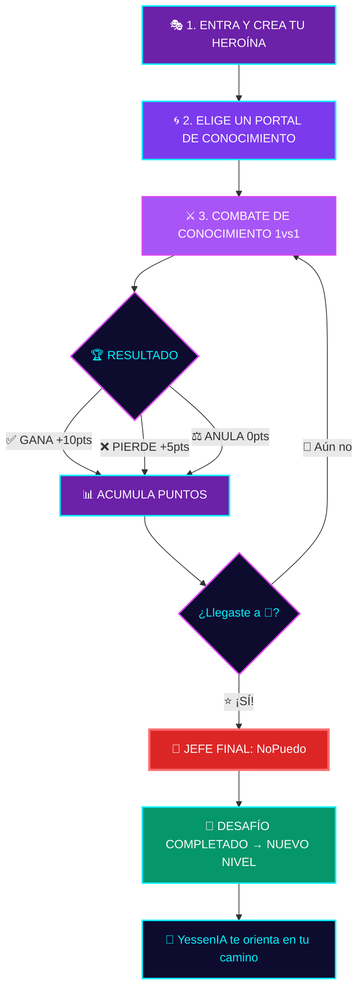

<div align="center">

<!-- HEADER BANNER -->


<br/>

<!-- LOGO -->
<!-- Reemplaza con la ruta real de tu logo -->
<!--  -->

<br/>

### 🎮 *Descubre tu futuro jugando. Crea tu heroína. Conquista tu camino.*

<br/>

[](https://herow.app)
[](.)
[](.)
[](.)

<br/>

---


---

</div>

<br/>

## 🌀 ¿Qué es HEROW?

> **HEROW** es una plataforma gamificada que transforma la exploración vocacional en una aventura épica. A través de combates de conocimiento, heroínas peruanas y portales STEM, las adolescentes de **15 a 17 años** descubren su camino antes de enfrentarse al mundo de las universidades, institutos y el trabajo.

<div align="center">

```
╔══════════════════════════════════════════════════════════════╗
║                                                              ║
║   🌀  "A través de HEROW, sabrás cómo sería tu futuro"  🌀   ║
║                                                              ║
╚══════════════════════════════════════════════════════════════╝
```

</div>

**No es un test vocacional más.** Es un juego donde cada decisión, cada batalla y cada portal te acerca a descubrir quién puedes llegar a ser. 🔮

<br/>

## 🎮 ¿Cómo funciona?

<div align="center">



</div>

<br/>

## 🌟 Las 3 Fases de tu Aventura

<table align="center">
<tr>
<td align="center" width="33%">

### 🎭 Fase 1
**Crea tu Heroína**

Regístrate, responde 3 preguntas sobre tus intereses y elige una **heroína peruana** como tu avatar.

*Tu aventura comienza aquí* ✨

</td>
<td align="center" width="33%">

### 🌀 Fase 2
**Explora Portales STEM**

Elige temas que llamen tu atención. Entra a una sala y espera a tu rival.

*El conocimiento es tu poder* ⚡

</td>
<td align="center" width="33%">

### ⚔️ Fase 3
**Combate y Conquista**

Rondas rápidas: elige, ordena, detecta errores y decide. ¡Acumula 100 puntos para desbloquear al Jefe Final!

*Demuestra lo que sabes* 🔥

</td>
</tr>
</table>

<br/>

## 👾 El Jefe Final: **NoPuedo**

<div align="center">

> *"NoPuedo es esa voz que te dice que no eres suficiente. En HEROW, la derrotas con hechos."*

</div>

Cuando alcanzas **100 puntos**, aparece el Jefe Final: **NoPuedo**. Para vencerlo, debes completar un **desafío práctico** del mundo real:

- 📝 Crear un perfil profesional
- 🎨 Presentar un proyecto creativo
- 💡 Resolver un caso práctico de tu área de interés

**¡Vencer a NoPuedo significa que estás lista para el siguiente nivel!** 🚀

<br/>

## 🤖 YessenIA — Tu Guía con Inteligencia Artificial

<div align="center">

```
  ╭─────────────────────────────────────────────────╮
  │  🤖 YessenIA te orienta durante todo el camino  │
  │                                                  │
  │  → Sugiere portales, cursos y oportunidades      │
  │    según tus intereses y lo que eliges explorar  │
  │                                                  │
  │  💡 La derrota no cierra tu ruta.                │
  │     Solo abre nuevos caminos.                    │
  ╰─────────────────────────────────────────────────╯
```

</div>

**YessenIA** analiza tu progreso y te recomienda:
- 🎓 Carreras y programas educativos
- 📚 Cursos y recursos de aprendizaje
- 🌐 Oportunidades reales en tu área de interés
- 🗺️ Rutas personalizadas hacia tu futuro

<br/>

## 🎨 Paleta de Colores

<div align="center">

| Color | Hex | Uso |
|:---:|:---:|:---|
| 🟣 | `#0D0B2E` | Fondo principal — Universo oscuro |
| 🔵 | `#00F0FF` | Acento principal — Energía cyan |
| 🟪 | `#A855F7` | Secundario — Portales púrpura |
| 🩷 | `#D946EF` | Destacado — Magenta vibrante |
| 💜 | `#6B21A8` | Profundo — Púrpura intenso |
| 🟢 | `#059669` | Éxito — Logros completados |

</div>

<br/>

## 🛠️ Stack Tecnológico

<div align="center">

[](https://nextjs.org/)
[](https://react.dev/)
[](https://www.typescriptlang.org/)
[](https://supabase.com/)
[](https://tailwindcss.com/)
[](https://vercel.com/)

</div>

<br/>

## 🚀 Instalación y Desarrollo

```bash
# 1️⃣ Clona el repositorio
git clone https://github.com/tu-usuario/herow.git

# 2️⃣ Entra al directorio
cd herow

# 3️⃣ Instala dependencias
npm install

# 4️⃣ Configura las variables de entorno
cp .env.example .env.local

# 5️⃣ Ejecuta en modo desarrollo
npm run dev
```

> 🌀 Abre [http://localhost:3000](http://localhost:3000) para ver la magia ✨

<br/>

## 📁 Estructura del Proyecto

```
herow/
├── 🌐 app/                  # Rutas y páginas (App Router)
│   ├── (auth)/               # Autenticación y registro
│   ├── (game)/               # Mecánicas de juego
│   ├── (portals)/            # Portales de conocimiento
│   └── layout.tsx            # Layout principal
├── 🧩 components/            # Componentes reutilizables
│   ├── ui/                   # Componentes de interfaz
│   ├── game/                 # Componentes del juego
│   └── ai/                   # Componentes de YessenIA
├── 🎨 styles/                # Estilos globales
├── 🔧 lib/                   # Utilidades y configuración
├── 📊 types/                 # Tipos TypeScript
└── 🌍 public/                # Assets estáticos
    ├── heroines/             # Avatares de heroínas
    └── portals/              # Assets de portales
```

<br/>

## 🤝 Contribuir

¿Quieres ser parte de la revolución vocacional? ¡Genial! 💜

1. 🍴 Haz fork del proyecto
2. 🌿 Crea tu rama (`git checkout -b feature/nueva-heroina`)
3. ✍️ Haz tus cambios y commitea (`git commit -m '🎭 Add: nueva heroína amazónica'`)
4. 📤 Sube tu rama (`git push origin feature/nueva-heroina`)
5. 🔁 Abre un Pull Request

<br/>

## 👥 Equipo

<div align="center">

| Rol | Descripción |
|:---:|:---|
| 🎨 **Diseño UX/UI** | Experiencias que enamoran a la Gen Z |
| 💻 **Desarrollo** | Código que construye futuros |
| 🤖 **IA & Datos** | YessenIA y análisis vocacional |
| 🎮 **Game Design** | Mecánicas que enganchan y enseñan |

</div>

<br/>

## 📄 Licencia

<div align="center">

Este proyecto está bajo la licencia **MIT** — mira el archivo [LICENSE](./LICENSE) para más detalles.

---

<br/>


<br/>

**Hecho con 💜 por el equipo HEROW**

*Porque tu futuro merece ser explorado, no improvisado.* 🌀

<br/>

[](https://herow.app)

</div>
