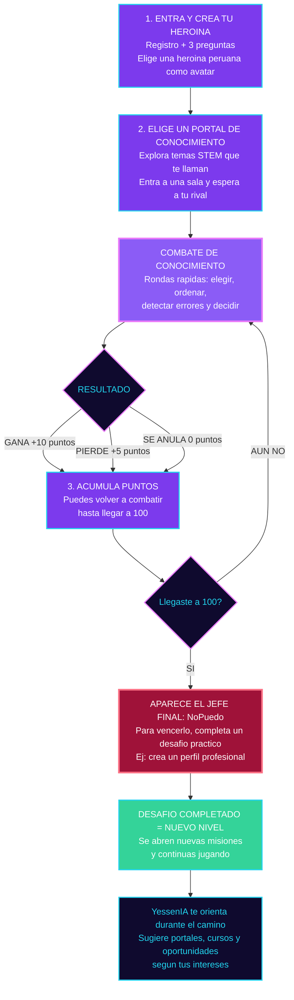
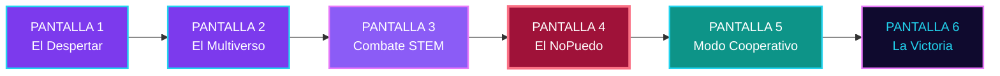
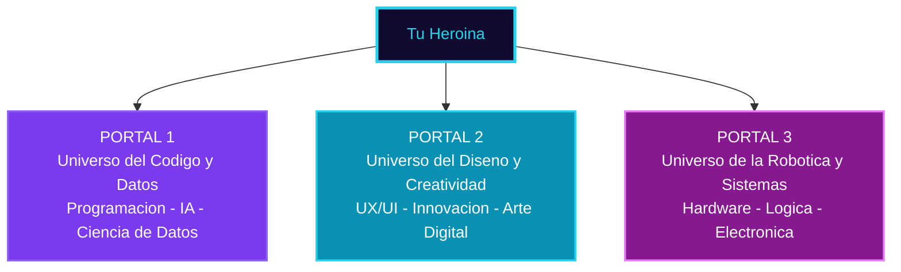
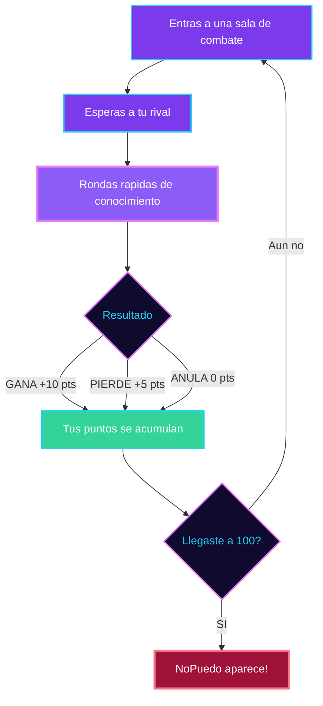
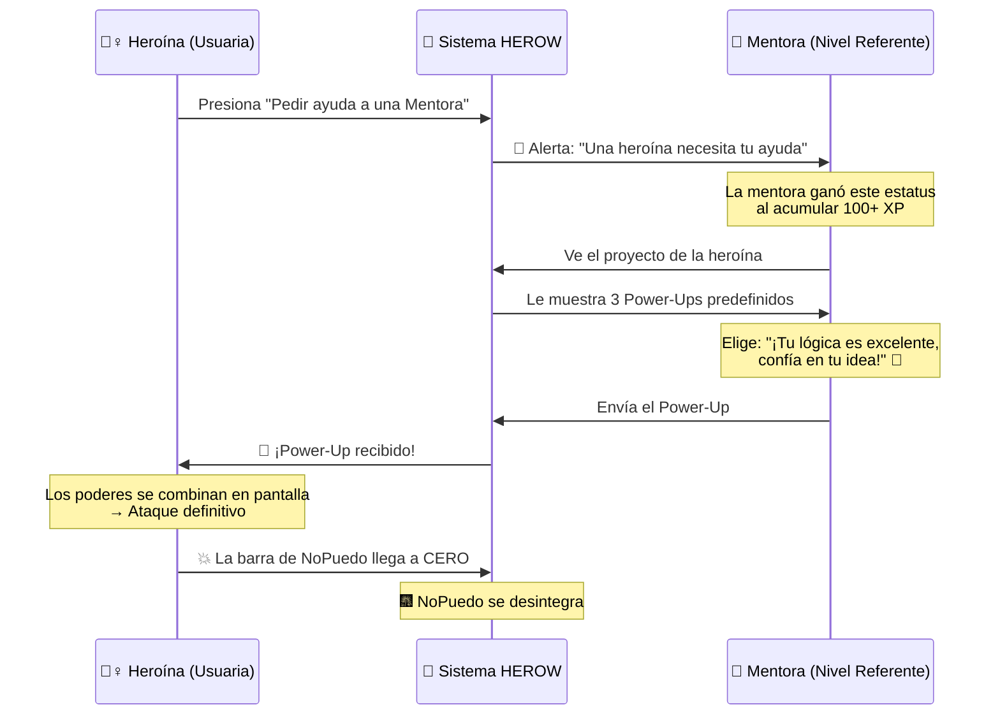

<div align="center">

<!-- HEADER BANNER -->


<br/>

<!-- LOGO: Descomenta y reemplaza con la ruta real de tu logo -->
<!--  -->

### ✨ *Descubre tu futuro jugando. Crea tu heroína. Conquista tu camino.*

<br/>

[](https://herow.app)
[](.)
[](.)
[](.)
[](.)

<br/>

---

<!-- TYPING SVG con caracteres URL-encoded para compatibilidad -->
<a href="https://git.io/typing-svg"></a>

---

</div>

<br/>

## 🌀 ¿Qué es HEROW?

**HEROW** no es un test vocacional más. Es una **plataforma gamificada** que transforma la exploración vocacional en una aventura épica donde **tú eres la protagonista**.

A través de misiones STEM, una IA que te guía y un sistema cooperativo de mentoras, las adolescentes de **15 a 17 años** descubren qué quieren ser **antes** de enfrentarse al mundo de universidades, institutos y el trabajo.

<div align="center">

```
  ╔════════════════════════════════════════════════════════════════╗
  ║                                                                ║
  ║   🌀  "A través de HEROW, sabrás cómo sería tu futuro"   🌀   ║
  ║                                                                ║
  ║      No improvisas tu futuro. Lo descubres jugando.            ║
  ║                                                                ║
  ╚════════════════════════════════════════════════════════════════╝
```

</div>

> 🔐 **Diseñado con seguridad para menores:** Sin chats abiertos, sin contacto directo entre usuarias. Toda interacción pasa por sistemas de feedback predefinidos supervisados por IA.

<br/>

---

## 🎮 Así Funciona el Juego

El flujo completo de HEROW sigue esta ruta — desde que creas tu heroína hasta que desbloqueas tu futuro:

<div align="center">



</div>

### ⚡ Sistema de Puntos

<table align="center">
<tr>
<td align="center" width="33%">

### ✅ GANA
**+10 puntos**

Respondiste mejor que tu rival

</td>
<td align="center" width="33%">

### ❌ PIERDE
**+5 puntos**

Perdiste, pero aprendiste algo nuevo

</td>
<td align="center" width="33%">

### ⚖️ SE ANULA
**0 puntos**

Empate — vuelve a intentar

</td>
</tr>
</table>

> 💡 **¿Por qué ganas puntos aunque pierdas?** Porque en HEROW, cada intento es aprendizaje. La derrota no cierra tu ruta, solo te impulsa a seguir.

### 🔓 ¿Cómo se desbloquean los niveles?

1. **Acumulas puntos** a través de combates de conocimiento
2. **Al llegar a 100 puntos** → aparece el **Jefe Final: NoPuedo**
3. **Vences al NoPuedo** completando un desafío práctico del mundo real
4. **Desafío completado** → Se desbloquea un **nuevo nivel** con nuevas misiones
5. **YessenIA** te orienta durante todo el camino sugiriendo portales, cursos y oportunidades
6. **El ciclo se repite** → Más portales, más combates, más niveles desbloqueados

<br/>

---

## 🗺️ Tu Aventura en 6 Pantallas

<div align="center">



</div>

<br/>

---

## 🎭 Pantalla 1: El Despertar

**`Registro y Creación de Heroína`**

> *Una interfaz oscura con destellos neón. En el centro, un orbe brillante cobra vida: es YessenIA, tu guía con IA.*

### ¿Cómo funciona?

Nada de formularios aburridos. **YessenIA** te hace solo **3 preguntas basadas en situaciones reales**:

<div align="center">

```
  ╭──────────────────────────────────────────────────────────────────╮
  │  🤖 YessenIA pregunta:                                          │
  │                                                                  │
  │  "El servidor de tu colegio se cayó y tu equipo debe             │
  │   entregar un trabajo urgente. ¿Qué haces?"                     │
  │                                                                  │
  │  (a) 🔍 Buscas otra app para hacerlo                             │
  │  (b) 👥 Organizas a todos para dividir el trabajo manual         │
  │  (c) 🎨 Dibujas cómo debería verse el trabajo final              │
  ╰──────────────────────────────────────────────────────────────────╯
```

</div>

### La Magia ✨

La IA procesa tus respuestas → la pantalla hace una **transición brillante** → y aparece tu **Avatar de Heroína**:

<table align="center">
<tr>
<td align="center" width="33%">

**🏗️ La Arquitecta de Soluciones**

*"Tu capacidad de encontrar herramientas demuestra Pensamiento Técnico"*

</td>
<td align="center" width="33%">

**👑 La Capitana de Equipos**

*"Tu forma de organizar demuestra Liderazgo Técnico"*

</td>
<td align="center" width="33%">

**🎨 La Visionaria Creativa**

*"Tu visión del resultado demuestra Diseño Estratégico"*

</td>
</tr>
</table>

<br/>

---

## 🌀 Pantalla 2: El Multiverso STEM

**`Elección de Portales de Conocimiento`**

> *Tu heroína está en el centro. Frente a ella flotan 3 Portales de Conocimiento — puertas dimensionales que brillan con energía STEM.*

<div align="center">



</div>

Tú eliges el portal que más te llama. Al tocarlo:

> 🌀 *"Has entrado al Universo de los Datos. Prepárate para tus primeras misiones."*

Entras a una sala y **esperas a tu rival**. Cuando ambas están listas, comienza el combate de conocimiento ⚔️

**Nadie te obliga. Tú decides qué explorar.** Eso es autonomía real 💜

<br/>

---

## ⚔️ Pantalla 3: Combate de Conocimiento

**`Rondas Rápidas STEM — Acumula Puntos hasta 100`**

> *Ambas jugadoras responden en vivo al mismo desafío. Rondas rápidas de elegir, ordenar, detectar errores y decidir. Cada respuesta cuenta.*

### 🎯 Tipos de rondas:

<table align="center">
<tr>
<td align="center" width="25%">

**🔍 Elegir**

Selecciona la respuesta correcta entre opciones

</td>
<td align="center" width="25%">

**📋 Ordenar**

Pon los pasos en el orden correcto

</td>
<td align="center" width="25%">

**🐛 Detectar errores**

Encuentra el fallo en el código o proceso

</td>
<td align="center" width="25%">

**💡 Decidir**

Toma la mejor decisión ante un escenario real

</td>
</tr>
</table>

### ⚡ Sistema de Puntos por Combate:

<div align="center">

```
  ╔══════════════════════════════════════════════════════════════╗
  ║                                                              ║
  ║   ✅ GANA        →  +10 puntos                               ║
  ║   ❌ PIERDE      →  +5 puntos  (siempre sumas algo)          ║
  ║   ⚖️ SE ANULA    →   0 puntos  (empate, vuelve a intentar)   ║
  ║                                                              ║
  ║   🎯 META: Acumula 100 puntos para desbloquear al NoPuedo    ║
  ║                                                              ║
  ╚══════════════════════════════════════════════════════════════╝
```

</div>

### 🔄 El Ciclo de Combate:

<div align="center">



</div>

> 💡 **¿Por qué sumas puntos aunque pierdas?** Porque en HEROW la derrota no cierra tu ruta. Cada combate es una oportunidad de aprender. Puedes volver a combatir cuantas veces quieras hasta llegar a 100.

### 🔐 ¿Es seguro el combate?

- ✅ **No hay chat** entre jugadoras durante el combate
- ✅ **Solo ven las preguntas y respuestas**, no información personal
- ✅ **Ambas responden al mismo desafío** en simultáneo
- ✅ **YessenIA modera** todo el proceso y detecta comportamiento inusual

<br/>

---

## 👾 Pantalla 4: La Guarida del "NoPuedo"

**`El Jefe Final — El Síndrome del Impostor`**

> *El diseño se vuelve tenso. Colores rojizos y morados oscuros invaden la pantalla. El monstruo "NoPuedo" ocupa la mitad de la pantalla, arrojando burbujas de texto...*

<div align="center">

```
  ╔═══════════════════════════════════════════════════════════╗
  ║                                                           ║
  ║              👾 N O P U E D O 👾                          ║
  ║                                                           ║
  ║     💬 "Eres muy chica para esto"                         ║
  ║     💬 "La tecnología es muy difícil para ti"             ║
  ║     💬 "Nadie te va a tomar en serio"                     ║
  ║                                                           ║
  ║     ████████████████████░░░░░ VIDA: 100%                  ║
  ║                                                           ║
  ╚═══════════════════════════════════════════════════════════╝
```

</div>

### La Batalla:

1. **YessenIA te dice:** *"Para vencerlo, estructura un proyecto para solucionar el problema de la basura en tu barrio"*
2. **Tú escribes tu idea** → Lanzas un ataque → Pero solo le quitas la **mitad de la vida** al monstruo
3. **La pantalla parpadea.** YessenIA advierte:

<div align="center">

> ⚠️ *"El NoPuedo es muy fuerte para vencerlo sola. Es hora de llamar a la caballería."*

### Aparece un botón dorado brillante:

```
  ╭─────────────────────────────────────────╮
  │                                         │
  │   ✨🛡️  PEDIR AYUDA A UNA MENTORA  🛡️✨  │
  │                                         │
  ╰─────────────────────────────────────────╯
```

</div>

> 🎯 **Mensaje clave:** Pedir ayuda NO es debilidad. Es la estrategia más poderosa que existe.

<br/>

---

## 🤝 Pantalla 5: Modo Cooperativo Seguro

**`La Interacción Asíncrona — Sin chats abiertos, 100% seguro`**

> *La pantalla se divide en dos. De un lado, tu Avatar. Del otro, aparece bajando del cielo el Avatar iluminado de una Mentora (una chica mayor que ya completó sus propios retos).*

### 🔐 ¿Por qué es seguro?

<table align="center">
<tr>
<td align="center" width="50%">

### 🔒 Lo que NO hay
- ❌ Chat abierto entre menores
- ❌ Contacto directo sin supervisión
- ❌ Mensajes personalizados libres
- ❌ Información personal visible

</td>
<td align="center" width="50%">

### ✅ Lo que SÍ hay
- ✅ Feedback predefinido por el sistema
- ✅ Power-Ups de apoyo controlados por IA
- ✅ Interacción asíncrona (no en tiempo real)
- ✅ Meritocracia automatizada

</td>
</tr>
</table>

### Así funciona:

<div align="center">



</div>

> 💜 **La mentora no fue elegida al azar.** Ganó ese estatus porque ella también venció a su propio NoPuedo. Eso es **meritocracia real**.

<br/>

---

## 🏆 Pantalla 6: La Victoria y El Salto al Mundo Real

**`El Puente entre el Juego y tu Futuro`**

> *Pantalla de celebración llena de luz. YessenIA reaparece coronando a tu Avatar. Has vencido al NoPuedo.*

### Tu recompensa:

<div align="center">

```
  ╔═══════════════════════════════════════════════════════════════╗
  ║                                                               ║
  ║              🏅 CERTIFICADO DE PERFIL DE HABILIDADES          ║
  ║                                                               ║
  ║                  "Heroína de Datos Junior"                    ║
  ║                                                               ║
  ║   Habilidades validadas:                                      ║
  ║   ✅ Pensamiento Técnico     ✅ Resolución de Problemas       ║
  ║   ✅ Liderazgo Colaborativo  ✅ Comunicación Efectiva         ║
  ║                                                               ║
  ╚═══════════════════════════════════════════════════════════════╝
```

</div>

### YessenIA te muestra el puente hacia tu futuro:

> *"Como dominaste el Universo de los Datos, aquí tienes tus oportunidades desbloqueadas:"*

<table align="center">
<tr>
<td align="center" width="50%">

**📚 Formación**

🎓 [Iniciar curso en Cisco Networking Academy]

🌐 [Reclamar ruta introductoria en AWS]

📖 [Acceder a cursos de Google para Educación]

</td>
<td align="center" width="50%">

**🚀 Oportunidades**

💼 [Pasantías tech para jóvenes en tu región]

🤝 [Comunidad de heroínas HEROW]

🌍 [Becas STEM para mujeres]

</td>
</tr>
</table>

### El Ciclo de Vida 🔄

<div align="center">

```
  ╭──────────────────────────────────────────────────────────────────╮
  │                                                                  │
  │  🌟 "Has acumulado 100 puntos. ¡Felicidades, acabas de          │
  │      desbloquear el MODO MENTORA!"                               │
  │                                                                  │
  │  👑 ¿Estás lista para ayudar a la siguiente heroína             │
  │     a vencer su miedo?                                           │
  │                                                                  │
  │              ✨ [ ACTIVAR MODO MENTORA ] ✨                       │
  │                                                                  │
  ╰──────────────────────────────────────────────────────────────────╯
```

</div>

> 🔁 **La heroína de hoy es la mentora de mañana.** Así se construye una comunidad que se sostiene sola.

<br/>

---

## 🤖 YessenIA — El Corazón de HEROW

**YessenIA** no es un chatbot cualquiera. Es una IA que te acompaña en **toda** tu aventura:

| Momento | ¿Qué hace YessenIA? |
|:---|:---|
| 🎭 **Registro** | Te hace 3 preguntas situacionales para descubrir tu perfil |
| 🌀 **Portales** | Te sugiere qué universo explorar según tus respuestas |
| ⚔️ **Combates** | Modera los enfrentamientos y te da feedback tras cada ronda |
| 🗺️ **Progreso** | Trackea tus puntos y te avisa cuando estás cerca del NoPuedo |
| 👾 **Jefe Final** | Te guía en la batalla y te conecta con una mentora |
| 🏆 **Victoria** | Te recomienda cursos, becas y oportunidades reales |
| 👑 **Modo Mentora** | Te orienta para ser la mejor guía posible |

<br/>

---

## 🎨 Paleta de Colores — Futurista y Sin Miedo

> *Colores inspirados en el logo de HEROW: morado, rosado y celeste — una paleta futurista que dice "tu futuro es brillante y no debes tenerle miedo".*

<div align="center">

| Color | Hex | Nombre | Rol en HEROW |
|:---:|:---:|:---:|:---|
| 🟣 | `#8B5CF6` | **Morado Portal** | Portales dimensionales — donde tu futuro te espera |
| 💜 | `#7C3AED` | **Morado Profundo** | Elementos principales — la base de tu aventura |
| 🩷 | `#E879F9` | **Rosado Neón** | Destacados y energía — tu poder brilla |
| 🔵 | `#22D3EE` | **Celeste Futuro** | Acentos y guías — el color de YessenIA y el camino |
| ⬛ | `#0F0A2E` | **Noche Cósmica** | Fondo principal — el universo donde exploras |
| 🟢 | `#34D399` | **Verde Logro** | Éxito — misiones completadas y nodos desbloqueados |
| 🔴 | `#9F1239` | **Rojo NoPuedo** | Peligro — la guarida del Jefe Final |
| 🟡 | `#FBBF24` | **Dorado Heroína** | Power-Ups, botones de logro y certificados |

</div>

<br/>

---

## 🛠️ Stack Tecnológico

<div align="center">

[](https://react.dev/)
[](https://vite.dev/)
[](https://expressjs.com/)
[](https://ai.google.dev/)
[](https://platform.openai.com/)
[](https://useportal.co/)

</div>

<br/>

---

## 🔐 Seguridad y Ética en IA

HEROW está diseñado con la protección de menores como **prioridad absoluta**:

- 🛡️ **Sin chats abiertos** — Toda comunicación pasa por sistemas predefinidos
- 🤖 **IA supervisada** — YessenIA filtra y modera todo el contenido
- 🔒 **Datos protegidos** — Sin exposición de información personal entre usuarias
- 📋 **Feedback controlado** — Las mentoras solo envían Power-Ups predefinidos
- ✅ **Cumplimiento ético** — Principios de IA responsable integrados en el diseño

<br/>

---

## 🚀 Instalación y Desarrollo

Requisitos: Node.js 22 o superior, un proyecto de Supabase, claves de Gemini y OpenAI, y un proyecto de Portal.

```bash
# 1️⃣ Instala todo (raíz, frontend y backend)
npm run setup

# 2️⃣ Variables de entorno (ver los comentarios de cada archivo)
cp server/.env.example server/.env              # claves secretas: Supabase, Gemini, OpenAI, Portal (sk_)
cp frontend/.env.example frontend/.env.local    # solo públicas: Supabase publishable, Portal pk_

# 3️⃣ Base de datos: pega supabase/schema.sql en Supabase → SQL Editor → Run (una sola vez)

# 4️⃣ Levanta backend + frontend
npm run dev
```

> 🌀 Juego en [http://localhost:5173](http://localhost:5173) · API en [http://localhost:3001/api/health](http://localhost:3001/api/health)

### 🎬 Demo
Con `DEV_TOOLS=true` en `server/.env`, la pantalla **Entrar** muestra botones para las cuentas de demo (sin contraseña):

- `herow_demo`: nivel 2, 980 pts, 7 heroínas. Lista para mostrar la misión del nivel 3, el jefe y la subida de nivel.
- `herow_demo2`: la rival para una partida **en vivo** (ábrela en otro navegador o en `http://[::1]:5173`).

`npm run demo:seed --prefix server` reinicia ambas cuentas antes de cada presentación. En el combate aparece **+50 demo** para sumar puntos rápido.

### 🧰 Comandos

| Comando | Qué hace |
|---|---|
| `npm run dev` | Backend (:3001) + frontend (:5173) |
| `npm run assets` | Procesa las imágenes de `assets/raw/` a pixel art |
| `npm run test:schema` | Prueba `supabase/schema.sql` en un Postgres local |
| `npm run check:ai` | Verifica que Gemini/OpenAI respondan bien |
| `npm run test:e2e --prefix server` | Prueba de punta a punta (registro, combate, misión, nivel, oportunidades, seguridad) |
| `npm run test:live --prefix server` | Partida en vivo real entre 2 jugadoras por Portal |
| `npm run portal:deploy` | Despliega `portal/portal.config.ts` |

### 🌀 Waitlist (colegios, aliados, inversores)

La landing tiene la sección **Súmate al portal** (`#sumate`): un formulario público que
guarda contactos en la tabla `leads`. Pensado para ferias y demos.

| Qué | Dónde |
|---|---|
| Formulario | [`frontend/src/components/WaitlistForm.jsx`](frontend/src/components/WaitlistForm.jsx) |
| Envío con cola offline | [`frontend/src/lib/leads.js`](frontend/src/lib/leads.js) |
| API | `POST /api/leads` · `GET /api/leads/count` · `GET /api/leads/export?token=…` |
| Tabla | `public.leads` (RLS activo, sin políticas: solo el backend escribe) |

- **Sin internet no se pierde nada.** Si el backend no responde, el correo se guarda en el
  navegador y se reenvía solo cuando vuelve la conexión.
- **Anti-spam** con campo trampa invisible, sin captcha ni servicios externos.
- **Correo repetido** no da error: completa los datos que falten.
- **Exportar los contactos** después del evento: pon `LEADS_ADMIN_TOKEN` en `server/.env` y abre
  `PUBLIC_URL/api/leads/export?token=EL_TOKEN` → descarga un CSV que Excel abre con tildes.

> ⚠️ Para que funcione en producción, el backend debe aceptar al frontend:
> `CORS_ORIGIN=https://herow-six.vercel.app` en Railway y `VITE_API_URL=https://herow-api-production.up.railway.app` en Vercel.

### 🏅 Carrusel de aliados

Banda de logos en bucle infinito, justo debajo del hero. Datos en
[`frontend/src/data/aliados.js`](frontend/src/data/aliados.js), componente en
[`frontend/src/components/Aliados.jsx`](frontend/src/components/Aliados.jsx).

Para añadir un logo: pon el SVG en `frontend/public/assets/logos/` y agrégalo a la lista.
La velocidad se ajusta sola según cuántos haya. `escala` afina uno concreto si se ve
descompensado; `url` vacío = no es clicable.

Cómo funciona el bucle: la lista se pinta **dos veces** y la cinta se desplaza `-50%`.
El espacio entre logos va como `margin-right` de cada chip, **no** como `gap` de la cinta —
con `gap` la mitad del track no equivale a una copia completa y el bucle salta medio hueco
en cada vuelta.

> 🎨 Los logos van **sin fondo**, directo sobre la banda oscura. Para que todos se lean
> hubo que recolorear **MovilMax** (su azul marino `#1B265B` era invisible → sus trazos
> oscuros pasan a blanco, el icono celeste queda intacto). AWS usa su PNG oficial con
> texto blanco, recortado para quitarle el relleno transparente. Los originales están en
> `assets/raw/logos/`.
>
> Si añades un logo oscuro, revisa su luminosidad antes: lo que no se ve sobre `--ink`
> hay que aclararlo igual.

**La unión con el hero** es un degradado, no un corte. Tres piezas que van juntas:

1. `.title-hero::after` — degradado vertical que disuelve la ciudad pixel en `--ink`,
   sólido desde el 94% para que la imagen nunca asome por abajo.
2. `.aliados-banda` con `margin-top: -2px` — cubre la última fila de la imagen. Sin esto
   aparece una línea brillante de lado a lado en la unión.
3. El mismo halo morado en los dos (`radial-gradient`), anclado abajo en el hero y arriba
   en la banda, para que el resplandor cruce sin escalón.

La banda además termina en `#150E3D`, el color de la sección siguiente, así que tampoco
tiene borde inferior.

### 👋 Sección "Nosotros"

El equipo y el premio salen en `#nosotros`, justo antes del formulario. Los datos están en
[`frontend/src/data/equipo.js`](frontend/src/data/equipo.js): nombre, rol, detalle, foto y
`linkedin` (vacío = no se muestra el enlace).

Las fotos van en `frontend/public/assets/nosotros/` en **.webp**. Los originales pesados se
guardan en `assets/raw/nosotros/`, que git ignora y no se despliega. Para procesar una foto nueva:

```bash
node -e "require('sharp')('entrada.png').resize(440,440,{fit:'cover',position:'top'}).webp({quality:82}).toFile('frontend/public/assets/nosotros/nombre.webp')"
```

### ⚖️ Páginas legales y footer

| Ruta | Qué contiene |
|---|---|
| `/privacidad` | Qué datos se piden, con quién se procesan, moderación, derechos (Ley 29733) |
| `/terminos` | Reglas de uso, límites de la IA, oportunidades de terceros, licencia |
| `/seguridad` | Para apoderados y docentes: por qué no hay chats ni contacto directo |

Los tres textos viven en [`frontend/src/data/legal.js`](frontend/src/data/legal.js) y se
pintan con [`frontend/src/views/Legal.jsx`](frontend/src/views/Legal.jsx). El footer es
[`frontend/src/components/Footer.jsx`](frontend/src/components/Footer.jsx) y se usa en la
landing y en las páginas legales.

> 📇 **Correo y redes se cambian en un solo sitio:** [`frontend/src/data/contacto.js`](frontend/src/data/contacto.js).
> Lo que dejes vacío simplemente no aparece en la web — nada se rompe.

El formulario de waitlist pide **consentimiento explícito** antes de guardar el correo y
registra la fecha en `leads.consent_at`, que también sale en el CSV de exportación.

### ☁️ Producción

| Parte | Servicio | URL |
|---|---|---|
| Frontend | Vercel (proyecto `herow`) | https://herow-six.vercel.app |
| Backend | Railway (proyecto `herow`, servicio `herow-api`) | https://herow-api-production.up.railway.app |
| Base de datos | Supabase | — |
| Tiempo real | Portal | — |

- **Backend:** `cd server && railway up --service herow-api`. Variables: `node tools/railway-env.mjs --frontend https://herow-six.vercel.app` (lee `server/.env`, nunca sube el archivo).
- **Frontend:** `cd frontend && vercel deploy --prod`. Variables `VITE_*` en el proyecto de Vercel.
- **Portal:** el dominio del frontend debe estar en los orígenes permitidos: `npx portal origins add https://herow-six.vercel.app`.
- En producción `DEV_TOOLS=false`: no hay atajos de puntos ni botones de demo; se entra con usuario y contraseña.

### 🧠 Cómo funciona
- **Niveles:** 500 / 1000 / 1500 puntos + una misión real (perfil profesional → primer post → mini proyecto) que revisa la IA + un paso en el mundo real (LinkedIn o portafolio, postular a una oportunidad) + vencer al NoPuedo.
- **Agente:** ajusta la dificultad según tu precisión, genera preguntas nuevas con IA, busca becas y cursos reales cada 12 h (verifica enlaces, resume, detecta convocatorias cerradas) y los ordena según tu desempeño.
- **En vivo:** emparejamiento 1 vs 1 por portal con Portal; el servidor decide preguntas, tiempos y puntos. Solo hay reacciones, no chat.
- **Seguridad:** sin email de las chicas, verificación de edad en el servidor, moderación de OpenAI en todo texto, RLS sin acceso directo del navegador a la base.

<br/>

---

## 📁 Estructura del Proyecto

```
MusuqLab/
├── 🖼️ assets/
│   ├── README.md               # Qué imagen va en cada carpeta y con qué nombre
│   └── raw/                    # Originales de ChatGPT (no se suben a git)
├── 🌐 frontend/                # React + Vite
│   ├── public/assets/          # Imágenes y audio procesados que usa el juego
│   └── src/
│       ├── views/              # Pantallas del juego
│       ├── components/         # YessenIA, partículas, UI
│       ├── data/               # Heroínas, portales, rutas de assets
│       └── lib/api.js          # Cliente del backend
├── 🤖 server/                  # Node + Express
│   ├── scripts/                # generate-portal-keys.js
│   └── src/
│       ├── routes/             # /api/yessenia, /api/recommendations, /api/portal
│       ├── services/           # IA (Gemini/OpenAI), moderación, scraping, tokens Portal
│       └── data/               # Prompt de YessenIA, fuentes de recomendaciones
└── 🛠️ tools/process-assets.mjs  # Pixelado y limpieza de imágenes
```

<br/>

---

## 🤝 Contribuir

¿Quieres ser parte de la revolución vocacional? ¡Genial! 💜

1. 🍴 Haz fork del proyecto
2. 🌿 Crea tu rama (`git checkout -b feature/nueva-heroina`)
3. ✍️ Haz tus cambios y commitea (`git commit -m '🎭 Add: nueva heroína amazónica'`)
4. 📤 Sube tu rama (`git push origin feature/nueva-heroina`)
5. 🔁 Abre un Pull Request

<br/>

---

## 👥 Equipo

<div align="center">

| Rol | Misión |
|:---:|:---|
| 🎨 **Diseño UX/UI** | Experiencias que enamoran a la Gen Z |
| 💻 **Desarrollo** | Código que construye futuros |
| 🤖 **IA & Datos** | YessenIA y análisis vocacional |
| 🎮 **Game Design** | Mecánicas que enganchan y enseñan |
| 🔐 **Seguridad** | Protección de menores como prioridad |

</div>

<br/>

---

## 📄 Licencia

<div align="center">

**Proyecto privado.** El código, la marca HEROW, el arte y los textos pertenecen al equipo
MusuqLab. Todos los derechos reservados. No está permitido copiar, distribuir ni reutilizar
este material sin permiso por escrito.

---

<br/>


<br/>

**Hecho con 💜 por el equipo HEROW**

*Porque tu futuro merece ser explorado, no improvisado.* 🌀

*La heroína de hoy es la mentora de mañana.* 👑

<br/>

[](https://herow.app)

</div>
